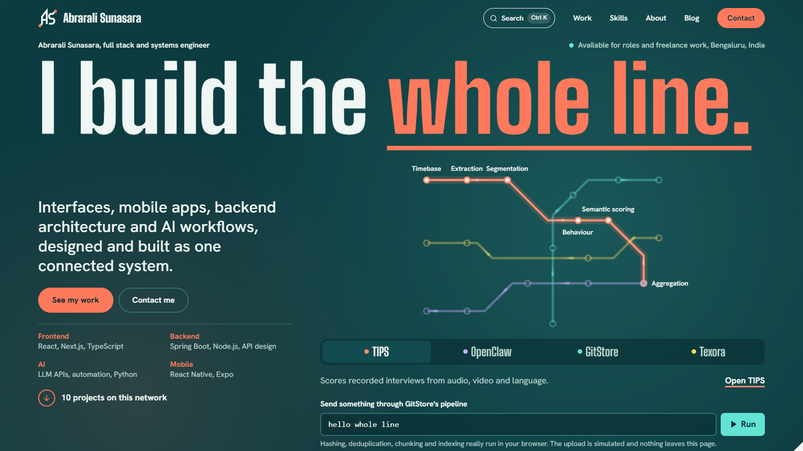

# Personal Portfolio — Abrarali Sunasara

[](https://reactjs.org/)
[](https://www.typescriptlang.org/)
[](https://tailwindcss.com/)
[](https://nextjs.org/)
[](https://vercel.com/)

A modern, high-performance developer portfolio showcasing **AI Systems, Full-Stack Applications, and Distributed Architecture**.

**Live Demo:** [https://abrarali.vercel.app/](https://abrarali.vercel.app/)


_The home page hero: every line on the system map is a real pipeline from one of the projects._

---

## About

This portfolio is a curated showcase of my journey as a **Full Stack & Systems Engineer**. It serves as a technical deep-dive into complex systems, AI integrations, and scalable architectures designed for recruiters and engineering teams.

My work focuses on bridging the gap between robust backend systems and intuitive, high-performance user interfaces, with a special emphasis on **AI-driven automation** and **multimodal analysis**.

---

## Key Highlights

- **AI + System Design Focus**: Specialized projects like TIPS (Multimodal Analysis) and OpenClaw (Agent Orchestration).
- **Fully Responsive**: Mobile-first design using modern CSS Grid and Flexbox.
- **Data-Driven Architecture**: Dynamic project and achievement rendering from centralized JSON configurations.
- **Optimized Performance**: High Lighthouse scores through asset optimization and efficient React patterns.

---

## Tech Stack

### **Frontend**

- React 18, Next.js 15 (App Router)
- TypeScript (Strict Mode)
- Tailwind CSS base with a token-driven design system in `src/app/globals.css`
- CSS animations, scroll-driven timelines and the View Transitions API (no animation library)

### **Backend & APIs**

- Node.js, Express, FastAPI (Python)
- RESTful API Design
- WebRTC (Multimodal streaming)

### **AI & Systems**

- LLMs (Qwen, GPT-4, Llama via OpenRouter)
- Transformers (Whisper, MediaPipe)
- Vector Databases & Semantic Scoring

### **Tools & Infrastructure**

- Docker (Containerization)
- Git & GitHub Actions
- Vercel (Deployment)
- Cloudflare (DNS & Optimization)

---

## Architecture Overview

The portfolio is built with a **modular, data-driven architecture** to ensure maintainability and scalability.

- **Hero**: `src/app/components/home` holds the system map, a working browser version of GitStore's upload pipeline (`pipeline-demo.ts`) and a WebGL2 layer (`hero-gl.ts`) that loads after the page and removes itself on slow devices.
- **Blog**: Articles live in `utils/Data/posts` as typed content blocks, rendered at build time with no client JavaScript. Adding a post also updates the listing, footer, sitemap and related project pages.
- **Data-Driven Design**: All projects, skills, and achievements are managed via centralized JSON/TypeScript data files (`/utils/Data`). This allows for adding new content without touching component logic.
- **Component Structure**: Reusable components (ProjectCard, RouteDiagram, Gallery, Reveal) grouped by area under `src/app/components`.
- **Project Origin**: Each project in `utils/Data/projects-data.ts` has an `origin` (`personal`, `client` or `prototype`) that drives its label and the origin filter, and a `line` that sets its discipline colour.
- **Dynamic Routing**: Uses Next.js Dynamic Routes (`/projects/[id]`) to render detailed project deep-dives from a single template.
- **Hybrid Rendering**: Combines Static Site Generation (SSG) for performance with Client-side interactivity for animations and galleries.

---

## Featured Projects

### [TIPS — Temporal Interview Profiling System](https://abrarali.vercel.app/projects/1)

A multimodal AI system that analyzes recorded video interviews using audio, video, and LLM-based semantic evaluation to generate objective, time-evolving candidate assessments.

### [GitStore — GitHub-Based Distributed File System](https://abrarali.vercel.app/projects/3)

A distributed storage solution that leverages GitHub's infrastructure as a version-controlled file system, featuring encryption and chunked uploads.

### [SurveySense — AI-Powered Survey Platform](https://abrarali.vercel.app/projects/4)

An intelligent survey engine that uses AI to analyze sentiment, cluster responses, and generate automated summaries of participant feedback.

---

## Additional Projects

- **OpenClaw**: Multi-agent orchestration system for complex task execution.
- **BuySmart AI**: Intelligent shopping assistant with predictive analytics.
- **InvenTrack Pro**: Production-grade inventory management with barcode support.
- **DataTalk Pro**: Natural language to SQL database query assistant.
- **MovieBot**: AI-powered recommendation and movie insight platform.

---

## Adding Content

- **Project**: add an entry to `utils/Data/projects-data.ts`, with `origin` and `line`.
- **Article**: add a file to `utils/Data/posts`, register it in `index.ts`, and add a 1200 x 630 image at `public/blog/og/<slug>.png`.
- **Resume**: set `resume` in `utils/Data/PersonalData.ts`. Links then appear in the menu and footer.

---

## Run Locally

1. **Clone the repository**

   ```bash
   git clone https://github.com/AbraraliS/portfolio-exp
   cd portfolio-exp
   ```

2. **Install dependencies**

   ```bash
   npm install
   ```

3. **Add environment variables**
   Copy `example.env` to `.env.local` and set `RESEND_API_KEY` to enable the contact form.

4. **Run the development server**

   ```bash
   npm run dev
   ```

5. **Build for production**
   ```bash
   npm run build
   ```

---

## Folder Structure

```bash
/src
  /app           # Next.js App Router (Pages & Layouts)
    /components  # Reusable UI Components
    /projects    # Dynamic Project Detail Pages
  /Types         # TypeScript Interfaces & Types
/public
  /assets        # Project images & technical diagrams
/utils
  /Data          # Centralized content (JSON/TS)
/docs            # Documentation & README assets
```

---

## Performance & Optimization

- **Asset Optimization**: All images use the `next/image` component for lazy loading, WebP conversion, and responsive sizing.
- **Code Splitting**: Dynamic imports for heavy components to minimize the initial JS bundle.
- **Asset Caching**: PWA integration for offline support and faster subsequent loads.
- **On-demand Video**: The YouTube player loads only when someone presses play.

---

## Responsiveness

Built with a **Mobile-First** mindset:

- **Responsive Grids**: Project cards switch from 1 to 3 columns based on screen width.
- **Touch-Optimized**: Interactive galleries and lightboxes support touch gestures.
- **Fluid Typography**: Text scales naturally across devices using Tailwind's responsive utilities.

---

## Deployment

The portfolio is automatically deployed via **Vercel** with continuous integration from the main branch. Every push undergoes a build and lint check to ensure production stability.

---

## Contact

- **GitHub**: [github.com/AbraraliS](https://github.com/AbraraliS)
- **LinkedIn**: [linkedin.com/in/abraralis](https://linkedin.com/in/abraralis)
- **YouTube**: [youtube.com/@abraralis7](https://www.youtube.com/@abraralis7)

---

## Future Improvements

- [ ] **Blog Section**: Integration with MDX for technical writing.
- [ ] **Analytics Dashboard**: Custom dashboard to track project engagement.
- [ ] **CMS Integration**: Headless CMS for even easier content management.

---

© 2026 Abrarali Sunasara. Built with Next.js and Tailwind CSS.
